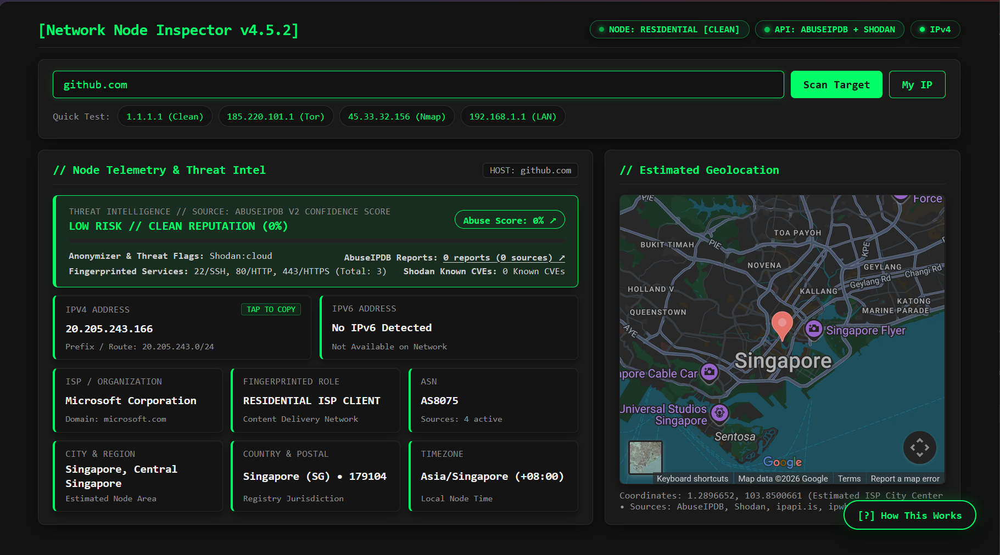
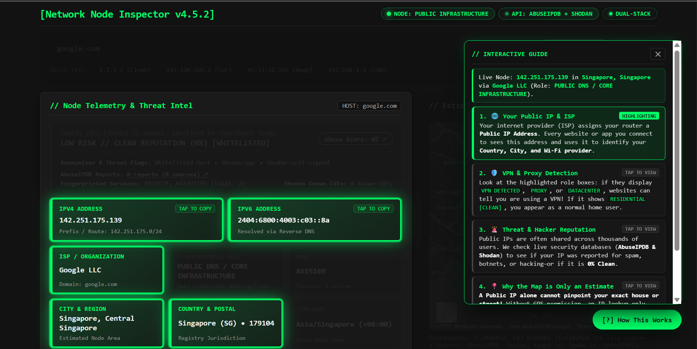
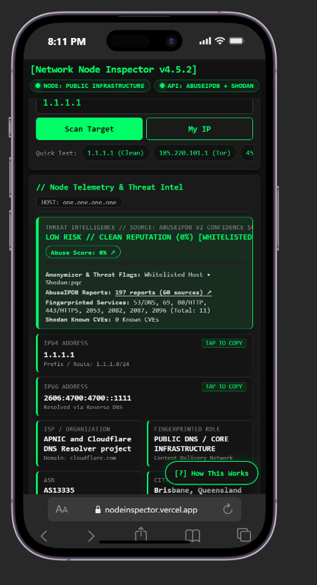
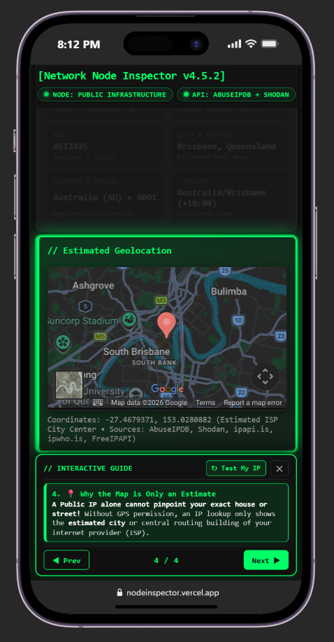

# Network Node Inspector v4.5.2

[](https://nodeinspector.vercel.app/)
[]() []()
[](https://t.me/h7n_unpacked)

A full-stack Open-Source Intelligence (OSINT) and network telemetry web application. This tool inspects IPv4, IPv6, and domain targets for AbuseIPDB reputation, Shodan open ports and CVEs, VPN/Tor/Proxy anonymizer flags, dual-stack DNS records, and multi-source geolocation.

You can access live demo(currently deployed in vercel) <a href="https://nodeinspector.vercel.app/" target="_blank">Click Me</a>
## 📖 Project History & Motivation

This is my **very first full-stack web project**. It originally started as a simple practice exercise to learn how to fetch and parse external APIs using JavaScript and Python. I utilized GEMINI Argon to help me with this web. As I dug deeper and as a cyber security student myself, I expand it into network telemetry and cybersecurity data. The scope expanded organically. What began as a basic IP lookup script evolved into a comprehensive, responsive OSINT dashboard with security hardening, concurrent backend processing, and an interactive UI.

## 🖥️ UI Showcase

### Desktop Terminal Interface
<p align="center">
  
</p>
<p align="center">
  
</p>

### Mobile Interface
<p align="center">
  
  &nbsp; &nbsp; &nbsp; &nbsp;
  
</p>

---
### 🚧 Challenges Tackled
* **CORS and API Rate Limits:** Early on, client-side fetches to certain APIs were blocked by CORS, or I quickly hit rate limits. **Solution:** I built a Flask Python backend to act as a proxy, hiding my API keys and aggregating requests securely.
* **Performance Bottlenecks:** Fetching 5 different threat intel APIs sequentially took 6-8 seconds. **Solution:** Implemented Python's `ThreadPoolExecutor` to run API calls concurrently, reducing wait times to under 2.5 seconds.
* **Security & XSS:** Passing raw JSON data into HTML `innerHTML` exposed the app to Cross-Site Scripting (XSS). **Solution:** Built a strict `escapeHTML()` sanitization function and enforced a robust Content Security Policy (CSP).
* **Responsive Design:** Displaying dense data (like 39-character IPv6 addresses) cleanly on mobile screens. **Solution:** Migrated to a dynamic CSS Bento Grid layout that reflows automatically based on the viewport.

### 🧠 What I Learned
* How to build a true client-server architecture bridging vanilla JavaScript and a Python Flask backend.
* The importance of strict input validation (e.g., stopping private RFC IP ranges before they hit the backend).
* How to securely manage environment variables (`.env`) and deploy serverless functions to Vercel.
* Web accessibility (WCAG 2.2 AA) basics, proper ARIA labeling, and keyboard focus states.

---

## ⚡️ Key Features

- **Multi-Engine Threat Intelligence:** Queries AbuseIPDB, Shodan InternetDB, ipapi.is, and ipwho.is concurrently.
- **🕵️ VPN, Tor & Proxy Detection (Leakage Prevention):** Instantly fingerprints your active connection to detect if your VPN, Tor exit node, or proxy is functioning correctly. If your real IP or DNS is leaking, the dashboard immediately exposes the mismatch to help you verify your privacy setup.
- **RFC Special-Purpose & Private Range Classifier:** Automatically intercepts non-routable IANA ranges (RFC 1918, RFC 6598, RFC 1122, RFC 3927, RFC 4193) before external queries are dispatched.
- **Dual-Stack (IPv4 + IPv6) & Reverse DNS:** Resolves domain `A`/`AAAA` records and IPv4 `PTR` records via Google DNS-over-HTTPS (DoH).
- **Interactive Spotlight Guide:** Built-in 4-step interactive onboarding tour that dims background elements and spotlights relevant telemetry cards.
- **Hardened Security Architecture:** Enforces strict CSP headers, server-side `ipaddress` validation, HTML entity escaping, bounded TTL caching, and sliding-window per-IP rate limiting.


## 🧭 Interactive Guide for Everyday Users

Network telemetry can be intimidating for non-technical users. To make OSINT data accessible to everyone, this app includes a built-in **Interactive Spotlight Guide**. 

By clicking the `[?] How This Works` floating button in the bottom right, users launch a step-by-step educational tour that dynamically interacts with the live dashboard:

- **Cinematic Dimming (Spotlight Effect):** When the guide opens, it applies a CSS glassmorphism effect that dims the background and brings specific telemetry cards to the front, highlighting exactly what the user should look at.
- **Contextual Explanations:** The guide walks users through 4 easy-to-understand concepts:
  1. **🌐 Public IP & ISP:** Explains how internet providers assign IPs and what they reveal.
  2. **🛡 VPN & Proxy Detection:** Shows users how websites can instantly tell if they are using a VPN, iCloud Private Relay, or Tor.
  3. **🚨 Threat Reputation:** Explains how public IPs get flagged for spam or hacking on AbuseIPDB.
  4. **📍 Geolocation Limits:** Clarifies that IP tracking only shows an *estimated city/region*, not an exact street address.
- **Live State Awareness:** The guide reads the current scan data and generates a live summary string (e.g., *"Live Node: 1.1.1.1 in Los Angeles via Cloudflare"*), keeping the tutorial relevant to the user's actual connection.


## 📱 Mobile Responsive UI
I tried my best to make the dashboard to feel like a native application on mobile devices (screens `<= 820px`):
- **Adaptive Bento Grid:** Telemetry cards seamlessly reflow. IPv4 and IPv6 cards expand to full width to prevent truncation, while smaller metadata boxes snap to a compact 2-per-row layout.
- **Touch-Optimized HUD:** The interactive guide converts from a floating desktop popover into an ultra-slim, bottom-anchored mobile drawer.
- **iOS Safari Safe:** Input fields use exactly `16px` font sizes to prevent forced zooming on iOS, and the app respects the `safe-area-inset-bottom`.

## 📡 External APIs & Privacy Disclosure

To provide aggregated OSINT data, this application communicates with several third-party services. **No lookup history or client IP logs are saved to disk.**

**Server-Side APIs (Queried securely by the Flask backend):**
- **[AbuseIPDB API v2](https://www.abuseipdb.com/):** (Requires API Key) Fetches 90-day abuse confidence scores, reports, and whitelists.
- **[Shodan InternetDB](https://internetdb.shodan.io/):** Fetches open ports, vulnerabilities (CVEs), and infrastructure tags.
- **[ipapi.is](https://ipapi.is/):** Detects VPNs, Tor exit nodes, open proxies, datacenters, and ASNs.
- **[ipwho.is](https://ipwhois.io/):** Fallback geolocation, UTC offset, and ISP connection data.

**Client-Side APIs (Queried directly by the user's browser):**
- **[Google DoH](https://dns.google/):** Resolves domains (`A`/`AAAA`) and performs reverse DNS (`PTR`) lookups.
- **[ipify](https://www.ipify.org/) / [ident.me](https://ident.me/):** Discovers the user's own dual-stack public IP addresses.
- **[GeoJS](https://www.geojs.io/) / [FreeIPAPI](https://freeipapi.com/):** Client-side geolocation and timezone resolution.
- **[Google Maps Embed](https://developers.google.com/maps/documentation/embed/get-started):** Renders the estimated city-center map pin.

## 🛠 Tech Stack
- **Frontend:** Vanilla HTML5, CSS3, ES6+ JavaScript (Zero UI frameworks)
- **Backend:** Python 3.12, Flask, `concurrent.futures`, `requests`
- **Deployment:** Vercel Serverless Python (`@vercel/python`)

## 🚀 Local Setup Guide

1. **Clone the repository:**
   ```bash
   git clone [https://github.com/YOUR_USERNAME/network-node-inspector.git](https://github.com/YOUR_USERNAME/network-node-inspector.git)
   cd network-node-inspector
   ```

2. **Create a virtual environment and install dependencies:**
   ```bash
   
   python -m venv .venv
   
   # On Windows:
   .venv\Scripts\activate

   
   # On macOS / Linux:
   source .venv/bin/activate
    
   pip install -r requirements.txt
   ```
   
3. **Configure Environment Variables:**
   ```bash
   cp .env.example .env
   ```

   Edit the .env file and paste your free AbuseIPDB API v2 Key.(Note: If you skip this step, the app will safely fall back to Shodan and Geo routing without AbuseIPDB scores).

4. **Run the local development server:**
   ```bash
   python app.py
   ```
   Open your browser and navigate to http://127.0.0.1:5000


 ## 💬 Connect with me
 Want to see more cybersecurity projects, networking articles, and software engineering deep-dives? 
 Also if you have any suggestions for me to update?
 Join my Telegram channel: **[t.me/h7n_unpacked](https://t.me/h7n_unpacked)** (or search for `h7n_unpacked`).
   


 ## ⚖️ License & Disclaimer
 

  **This tool is built for educational, defensive security, and OSINT research purposes. The geolocation data represents estimated routing infrastructure (ISP city centers), not exact physical GPS coordinates.**